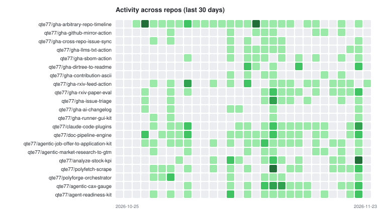

# Timelines

<!-- Auto-generated by scripts/generate-timeline.sh on every run; do not edit by hand. -->

| Repo | Open PRs | Open issues | Last activity | Chart |
|---|---|---|---|---|
| [qte77/gha-arbitrary-repo-timeline](qte77/gha-arbitrary-repo-timeline.md) | 0 | 3 | 2026-11-14 | [activity](../assets/qte77/gha-arbitrary-repo-timeline-activity.svg) |
| [qte77/gha-github-mirror-action](qte77/gha-github-mirror-action.md) | 0 | 6 | 2026-11-12 | [activity](../assets/qte77/gha-github-mirror-action-activity.svg) |
| [qte77/gha-cross-repo-issue-sync](qte77/gha-cross-repo-issue-sync.md) | 0 | 2 | 2026-11-13 | [activity](../assets/qte77/gha-cross-repo-issue-sync-activity.svg) |
| [qte77/gha-llms-txt-action](qte77/gha-llms-txt-action.md) | 0 | 2 | 2026-11-13 | [activity](../assets/qte77/gha-llms-txt-action-activity.svg) |
| [qte77/gha-sbom-action](qte77/gha-sbom-action.md) | 0 | 2 | 2026-11-15 | [activity](../assets/qte77/gha-sbom-action-activity.svg) |
| [qte77/gha-dirtree-to-readme](qte77/gha-dirtree-to-readme.md) | 2 | 1 | 2026-11-15 | [activity](../assets/qte77/gha-dirtree-to-readme-activity.svg) |
| [qte77/gha-contribution-ascii](qte77/gha-contribution-ascii.md) | 0 | 1 | 2026-11-12 | [activity](../assets/qte77/gha-contribution-ascii-activity.svg) |
| [qte77/gha-rxiv-feed-action](qte77/gha-rxiv-feed-action.md) | 4 | 5 | 2026-11-16 | [activity](../assets/qte77/gha-rxiv-feed-action-activity.svg) |
| [qte77/gha-rxiv-paper-eval](qte77/gha-rxiv-paper-eval.md) | 0 | 10 | 2026-11-15 | [activity](../assets/qte77/gha-rxiv-paper-eval-activity.svg) |
| [qte77/gha-issue-triage](qte77/gha-issue-triage.md) | 0 | 4 | 2026-11-14 | [activity](../assets/qte77/gha-issue-triage-activity.svg) |
| [qte77/gha-ai-changelog](qte77/gha-ai-changelog.md) | 0 | 2 | 2026-11-12 | [activity](../assets/qte77/gha-ai-changelog-activity.svg) |
| [qte77/gha-runner-gui-kit](qte77/gha-runner-gui-kit.md) | 2 | 0 | 2026-11-12 | [activity](../assets/qte77/gha-runner-gui-kit-activity.svg) |
| [qte77/claude-code-plugins](qte77/claude-code-plugins.md) | 3 | 18 | 2026-11-16 | [activity](../assets/qte77/claude-code-plugins-activity.svg) |
| [qte77/doc-pipeline-engine](qte77/doc-pipeline-engine.md) | 1 | 6 | 2026-11-15 | [activity](../assets/qte77/doc-pipeline-engine-activity.svg) |
| [qte77/agentic-job-offer-to-application-kit](qte77/agentic-job-offer-to-application-kit.md) | 0 | 16 | 2026-11-15 | [activity](../assets/qte77/agentic-job-offer-to-application-kit-activity.svg) |
| [qte77/agentic-market-research-to-gtm](qte77/agentic-market-research-to-gtm.md) | 0 | 1 | 2026-11-12 | [activity](../assets/qte77/agentic-market-research-to-gtm-activity.svg) |
| [qte77/analyze-stock-kpi](qte77/analyze-stock-kpi.md) | 0 | 2 | 2026-11-15 | [activity](../assets/qte77/analyze-stock-kpi-activity.svg) |
| [qte77/polyfetch-scrape](qte77/polyfetch-scrape.md) | 0 | 10 | 2026-11-15 | [activity](../assets/qte77/polyfetch-scrape-activity.svg) |
| [qte77/polyforge-orchestrator](qte77/polyforge-orchestrator.md) | 0 | 12 | 2026-11-13 | [activity](../assets/qte77/polyforge-orchestrator-activity.svg) |
| [qte77/agentic-cax-gauge](qte77/agentic-cax-gauge.md) | 0 | 4 | 2026-11-15 | [activity](../assets/qte77/agentic-cax-gauge-activity.svg) |
| [qte77/agent-readiness-kit](qte77/agent-readiness-kit.md) | 0 | 9 | 2026-11-15 | [activity](../assets/qte77/agent-readiness-kit-activity.svg) |
