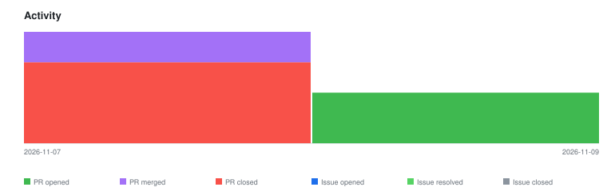

# qte77/agent-readiness-kit — Timeline

<!-- activity-svg-embed -->

<!-- open-section-start -->
## Open

- [ISSUE #77] ora.ai relevance on platform subdomains (*.pages.dev) flips API checks from n/a to fail (2026-10-06) [open]
- [ISSUE #74] oraAi: POST /api/scan serves a cached result, so scans after a deploy never see the change (2026-10-06) [open]
- [ISSUE #43] Crosswalk principle: present-but-non-functional discovery docs should score worse than absent ones (2026-09-18) [open]
- [ISSUE #25] [agent-readiness] sortmy-london remediation (2026-09-17) [open]
- [ISSUE #24] [agent-readiness] agenthud-agui-a2ui remediation (2026-09-17) [open]
- [ISSUE #23] [agent-readiness] qte77-github-io remediation (2026-09-17) [open]
- [ISSUE #17] Revisit dns-aid signal once a DNS agent-identity draft reaches consensus (2026-09-17) [open]
- [ISSUE #6] crosswalk.ts places api-catalog under Discovery; isitagentready.com groups it under "Protocol Discovery" — reconcile against upstream table (2026-09-16) [open]
- [ISSUE #5] Candidate crosswalk signal gaps surfaced by ora.ai / isitagentready.com comparison: a11y, WebMCP, Link response headers, ARD (2026-09-16) [open]
- [PR #98] chore(deps-dev): bump the worker-npm-minor-patch group in /worker with 3 updates (2026-11-09) [open]
- [PR #97] chore(deps-dev): bump @types/node from 22.20.3 to 26.6.6 (2026-11-09) [open]
- [PR #96] chore(deps-dev): bump vitest from 5.0.5 to 5.1.0 in the npm-minor-patch group (2026-11-09) [open]
- [PR #95] chore(deps): bump the actions-minor-patch group with 2 updates (2026-11-09) [open]
- [PR #94] chore(scan): update scan results (2026-11-09) [open]
- [PR #93] chore(scan): update scan results (2026-11-02) [open]
<!-- open-section-end -->

## History

2026-11-10

- [PR #91] chore(deps): bump the actions-minor-patch group across 1 directory with 3 updates (2026-10-26) [closed]
- [PR #90] chore(scan): update scan results (2026-10-26) [closed]
- [PR #86] chore(deps): bump the worker-npm-security group across 1 directory with 5 updates (2026-10-22) [closed]
- [PR #84] chore(deps): bump @vitest/mocker from 5.0.1 to 5.0.5 in the npm-security group across 1 directory (2026-10-22) [closed]
- [PR #81] chore(deps): bump the worker-npm-minor-patch group across 1 directory with 5 updates (2026-10-19) [closed]
- [PR #80] chore(scan): update scan results (2026-10-19) [closed]
- [PR #78] chore(scan): update scan results (2026-10-12) [closed]
- [PR #73] chore(scan): update scan results (2026-10-05) [closed]
- [PR #69] chore(deps-dev): bump @types/node from 22.20.3 to 26.6.2 (2026-09-28) [closed]
- [PR #68] chore(deps-dev): bump vitest from 5.0.1 to 5.0.5 in the npm-minor-patch group across 1 directory (2026-09-28) [closed]
- [PR #67] chore(scan): update scan results (2026-09-28) [closed]
- [PR #92] docs: describe external projects by role, not name (2026-10-29) [closed]

