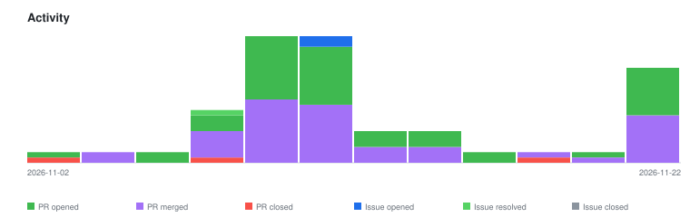

# qte77/agentic-cax-gauge — Timeline

<!-- activity-svg-embed -->

<!-- open-section-start -->
## Open

- [ISSUE #97] BENCH — label the 30 pilot runs blind (owner) (2026-11-13) [open]
- [ISSUE #94] BENCH-3 — benchmark design upgrades (band recompute test, control STLs, intent-only briefs, second rater, provenance, held-out set) (2026-11-13) [open]
- [ISSUE #25] MB — BIM preflight (IFC), data-gated (2026-10-06) [open]
- [ISSUE #17] M3 — Adoption (wire so101/i3mega to the gauge) (2026-09-19) [open]
<!-- open-section-end -->

## History

2026-11-23

- [PR #121] docs(plan): status update 2026-11-22 (2026-11-22) [closed]
- [PR #120] docs(landscape): LEAP71 as a whole: 21 repos, Chondrite and typed quantities (2026-11-22) [closed]
- [PR #119] test(bench): known-bad controls from agent-CAD videos (BENCH-3 item 2) (2026-11-22) [closed]
- [PR #118] docs(landscape): captions-off cause for 2 videos; YouTube RSS works from runners (§3.8) (2026-11-22) [closed]
- [PR #117] docs(landscape): what 12 more agent-CAD transcripts show (§3.8) (2026-11-22) [closed]
- [PR #116] feat(bench): briefs 16–18 from The Stack Underflow's labs (credited) (2026-11-22) [closed]
- [PR #115] docs: focus on the checking half agent-CAD demos skip; QuickTube transcripts; licence nuance (2026-11-22) [closed]
- [PR #114] docs(landscape): videos, transcripts and model repositories (§3.8) (2026-11-22) [closed]
- [PR #113] chore(claude): set Claude Code output and autocompact env (2026-11-22) [closed]
- [PR #112] docs: document provenance.py switches, index §3.7.2, CI link-flake learning (2026-11-21) [closed]
- [PR #111] chore(deps): Bump node from 22-bookworm-slim to 25-bookworm-slim in /bench/fly (2026-11-16) [closed]
- [PR #110] chore(deps): Bump astral-sh/uv from 0.13.7 to 0.13.8 in /bench/fly (2026-11-16) [closed]

2026-11-16

- [ISSUE #16] M2 — The honest gate (preflight, viewer, browser, render, report, cli) (2026-09-19) [closed]
- [PR #109] docs(landscape): AutoCAD and Revit logs as evidence (§3.7.2) (2026-11-15) [closed]
- [PR #108] docs(research): ArchLang — landscape entry and its eval method (2026-11-15) [closed]
- [PR #107] docs(plan): M3 has no consumer for now; park adoption, document the upstream probe (2026-11-15) [closed]
- [PR #106] chore: Fable review cleanup; pre-stage the M3 sitting; rank adjacent landscape entries low (2026-11-14) [closed]
- [PR #105] docs(landscape): Claude for Manufacturing, MecAgent refresh, Constor (2026-11-14) [closed]
- [PR #104] docs(plan): sync opening and BENCH-3 row with what #99–#103 shipped (2026-11-14) [closed]
- [PR #103] feat(bench): per-run provenance.json (BENCH-3 item 5) (2026-11-13) [closed]
- [PR #102] test(bench): recompute every brief's band from its closed form (BENCH-3 item 1) (2026-11-13) [closed]
- [PR #101] docs: benchmark-practice reference; re-gate benchmark rounds behind the pilot labels (2026-11-13) [closed]
- [PR #100] feat(bench): review rubric for labels and M3 defects; blind sheet accepts unsure (2026-11-13) [closed]
- [PR #99] test(bench): control parts for every brief's bounds (BENCH-3 item 2) (2026-11-13) [closed]
- [PR #98] chore(release): 0.3.0 — preflight-only verdict (exit 3), blind labelling, M3 campaign (2026-11-13) [closed]
- [PR #96] docs(plan): owner decisions 2026-11-13 — consumers archived, bench unparked, BENCH-3, deletions withdrawn (2026-11-13) [closed]
- [PR #95] feat(m3): review campaign over every so101 part (2026-11-13) [closed]
- [PR #93] chore(links): exclude two Hexagon URLs that 403 the CI runner (2026-11-13) [closed]
- [PR #92] feat(bench): blind labelling sheet for the pilot (2026-11-13) [closed]
- [PR #91] fix(bench): rescore.sh updates runs.tsv; Makefile comment names exit 3 (2026-11-13) [closed]
- [PR #90] docs(landscape): PhysicsX Ai.rplane note (2026-11-12) [closed]
- [PR #89] docs(readme): status badge says M2 closed, M3 next (2026-11-12) [closed]
- [PR #88] feat(report): preflight-only verdict (exit 3) for a run without a render (2026-11-12) [closed]
- [PR #87] fix(bench): record the real exit code instead of logging any non-zero as fail (2026-11-12) [closed]
- [PR #86] docs(plan): handoff for the next session — Fable review, ordered next steps (2026-11-12) [closed]
- [PR #85] docs: document bench tools, BENCH_TMP/BENCH_NO_RENDER and rescore.sh; CHANGELOG research entry (2026-11-12) [closed]
- [PR #84] docs(plan): PR numbers on shipped rows, Fly-trial gate, neutral merge step (2026-11-12) [closed]
- [PR #83] docs(reference): out-of-scope map companies with reasons and homepages; Cadence close confirmed (2026-11-12) [closed]
- [PR #82] docs(landscape): falsify and correct PR #79 CAx leads (2026-11-12) [closed]
- [PR #81] docs(landscape): Molitor whitepaper (KG lead resolved), OpenAI hardware post, map coverage audit (2026-11-12) [closed]
- [PR #80] docs(landscape): Molitor follow-up — Engineering AI ecosystem map; PhysicsX, Neural Concept (2026-11-12) [closed]
- [PR #79] docs(landscape, vendor-ai): BenchCAD 2.0, SimReady Central, MeltFlex, two Onshape posts (2026-11-12) [closed]
- [PR #78] docs(plan): close M2 — the owner's so101 review is the done-when (2026-11-11) [closed]
- [PR #77] docs(landscape): verify Fusion PCB claims at source (2026-11-11) [closed]
- [PR #76] docs(landscape): LEAP71 restructure, Rhino, Blender, PCB (KiCad vs Fusion) (2026-11-11) [closed]
- [PR #75] chore(deps): Bump astral-sh/uv from 0.13.6 to 0.13.7 in /bench/fly (2026-11-09) [closed]
- [PR #74] chore(ci): Bump the github-actions group with 2 updates (2026-11-09) [closed]
- [PR #69] chore(deps): Bump node from 22-bookworm-slim to 25-bookworm-slim in /bench/fly (2026-10-26) [closed]

2026-11-10

- [PR #73] chore(deps): Bump astral-sh/uv from 0.12.5 to 0.13.6 in /bench/fly (2026-11-02) [closed]
- [PR #71] chore(ci): Bump the github-actions group across 1 directory with 3 updates (2026-10-26) [closed]
- [PR #70] chore(deps): Bump astral-sh/uv from 0.12.5 to 0.13.5 in /bench/fly (2026-10-26) [closed]

