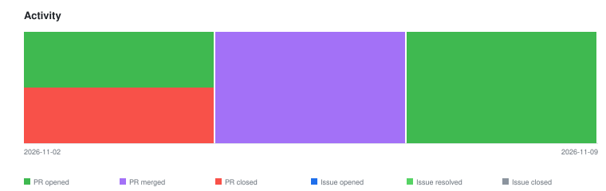

# qte77/agentic-cax-gauge — Timeline

<!-- activity-svg-embed -->

<!-- open-section-start -->
## Open

- [ISSUE #25] MB — BIM preflight (IFC), data-gated (2026-10-06) [open]
- [ISSUE #17] M3 — Adoption (wire so101/i3mega to the gauge) (2026-09-19) [open]
- [ISSUE #16] M2 — The honest gate (preflight, viewer, browser, render, report, cli) (2026-09-19) [open]
- [PR #75] chore(deps): Bump astral-sh/uv from 0.13.6 to 0.13.7 in /bench/fly (2026-11-09) [open]
- [PR #74] chore(ci): Bump the github-actions group with 2 updates (2026-11-09) [open]
- [PR #69] chore(deps): Bump node from 22-bookworm-slim to 25-bookworm-slim in /bench/fly (2026-10-26) [open]
<!-- open-section-end -->

## History

2026-11-10

- [PR #73] chore(deps): Bump astral-sh/uv from 0.12.5 to 0.13.6 in /bench/fly (2026-11-02) [closed]
- [PR #71] chore(ci): Bump the github-actions group across 1 directory with 3 updates (2026-10-26) [closed]

