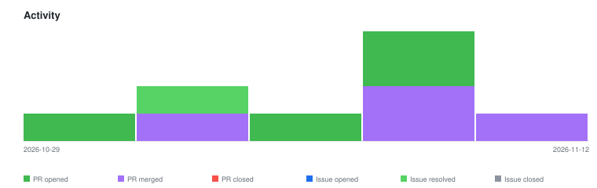

# qte77/agentic-market-research-to-gtm — Timeline

<!-- activity-svg-embed -->

<!-- open-section-start -->
## Open

- [ISSUE #20] docs: adopt README doc-structure canon (2026-06-21) [open]
<!-- open-section-end -->

## History

2026-11-23

- [PR #29] chore(claude): set Claude Code output and autocompact env (2026-11-22) [closed]
- [PR #28] ci(markdownlint): carry the shared rules in .markdownlint-cli2.jsonc (2026-11-20) [closed]
- [PR #27] chore(config): stop tracking local pipeline inputs (2026-11-18) [closed]
- [PR #26] chore(deps): bump qte77/.github/.github/workflows/lint-md-links.yml from 5dfff1f73ac7241ef37b6103e04d2a8373ff68a4 to 1aca0d7a65544327646027b7bce8393508578852 (2026-11-17) [closed]

2026-11-16

- [PR #25] ci: add grouped Dependabot config for GitHub Actions (2026-11-11) [closed]
- [PR #24] fix(ci): ignore placeholder links and drop dead rickxie.cn citation (2026-11-11) [closed]
- [PR #23] chore: stop tracking .claude/settings.local.json (2026-11-09) [closed]

2026-11-10

- [ISSUE #21] research inputs: agent pricing and positioning (LinkedIn opinion, 2026-10-22) (2026-10-22) [closed]
- [PR #22] docs: disposition of the pricing and positioning research inputs (#21) (2026-10-29) [closed]

