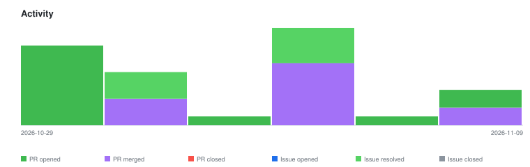

# qte77/claude-code-plugins — Timeline

<!-- activity-svg-embed -->

<!-- open-section-start -->
## Open

- [ISSUE #262] Review follow-ups: read-once cache hardening + small doc fixes (2026-10-26) [open]
- [ISSUE #243] Proposal: merge workspace-setup and workspace-sandbox (shared files, mutually exclusive) (2026-10-11) [open]
- [ISSUE #242] SKILL.md: Claude Code keys nested under metadata: are ignored (decision needed) (2026-10-11) [open]
- [ISSUE #236] pages-ops: finish the plugin (design snapshot sync, Pages build, agent-readiness and live checks, deploy) (2026-10-11) [open]
- [ISSUE #206] Agent-native readiness: Content-Signal + llms.txt check (2026-09-01) [open]
- [ISSUE #199] Proposal: session-archive — durable ~/.claude snapshot + restore (cc-meta corpus survives rebuilds) (2026-08-17) [open]
- [ISSUE #190] security-audit/mas-design: OWASP LLM Top 10 audit skill + ATLAS alignment (tracking) (2026-07-05) [open]
- [ISSUE #185] model governance: shipped bare aliases resolve unpredictably under consumer overrides; document resolution precedence (2026-07-05) [open]
- [ISSUE #178] Proposal: evaluating-agent-policy skill (adversarial ASR eval of a policy doc) (2026-06-23) [open]
- [ISSUE #177] Proposal: governance-gate plugin (PreToolUse hard gates) — weigh per-call overhead vs gain (2026-06-23) [open]
- [ISSUE #175] Opt mature skills into stability: stable + content-hash guard (2026-06-21) [open]
- [ISSUE #167] ci(security): restore CodeQL as a required check after fixing the local_only Actions policy (2026-06-17) [open]
- [ISSUE #158] research: is cc-meta:summarizing-session-end necessary? audit hook + handoff message + MEMORY.md role (2026-05-17) [open]
- [ISSUE #125] refactor: consider merging security-audit into codebase-tools (2026-04-21) [open]
- [ISSUE #101] Evaluate Graphify for skill dependency graph and cross-plugin analysis (2026-04-09) [open]
- [ISSUE #75] cc-voice: implement STT via Moonshine (/listen) (2026-04-05) [open]
- [PR #275] ci: bump the github-actions group with 3 updates (2026-11-08) [open]
- [PR #201] docs(agent-requests): flag the cc-meta MEMORY.md seed hook for retirement (2026-08-23) [open]
- [PR #200] feat(workspace-setup,workspace-sandbox): add unattended-execution rule (2026-08-18) [open]
- [PR #197] [PARKED] feat: add unattended-run kit to workspace-setup deployed set (pre-stages qte77 arc-003) (2026-07-28) [open]
<!-- open-section-end -->

## History

2026-11-10

- [PR #277] docs(rules): no operator commands in repo files (2026-11-09) [closed]
- [PR #276] chore: list .claude/settings.local.json in .gitignore (2026-11-09) [closed]
- [ISSUE #248] Docs deploy: verify the live GitHub Pages URL after deploying (2026-10-14) [closed]
- [ISSUE #247] Run the documented pre-push gate on pull requests (validate, check_sync, test_install, strict docs build) (2026-10-14) [closed]
- [ISSUE #187] chore: 22 SKILL.md files stale at last-verified-cc-version 1.0.34 (current CC 2.1.x) (2026-07-05) [closed]
- [ISSUE #157] Review necessity of cc-meta:orchestrating-parallel-workers skill (2026-05-17) [closed]
- [ISSUE #127] feat: extract sh-dev plugin — BATS testing, ShellCheck, shell best practices (2026-04-23) [closed]
- [ISSUE #126] feat(cc-meta): session handoff reminder via Stop hook (2026-04-21) [closed]
- [ISSUE #48] cc-meta: add goals.json as bigpicture data source + Goal Progress output (2026-03-27) [closed]
- [PR #274] ci: bump astral-sh/setup-uv from 10.3.2 to 10.3.3 in the github-actions group (2026-11-01) [closed]
- [PR #273] docs: describe private projects by role, not name (2026-10-29) [closed]
- [PR #272] feat(sh-dev): extract a shell plugin with BATS and ShellCheck skills (2026-10-29) [closed]
- [PR #271] docs(changelog): add the 2026-10-29 lane entries and plan status (2026-10-29) [closed]
- [PR #270] chore: replace per-skill last-verified-cc-version with one repo statement (2026-10-29) [closed]
- [PR #269] ci(docs): verify the live Pages URL after deploying (2026-10-29) [closed]
- [PR #268] ci: run the pre-push gate on pull requests (2026-10-29) [closed]
- [PR #267] refactor(cc-meta): retire orchestrating-parallel-workers (2026-10-29) [closed]
- [PR #266] feat(cc-meta): remind to hand off via a Stop hook (2026-10-29) [closed]
- [PR #265] feat(cc-meta): read goals.json in bigpicture and render Goal Progress (2026-10-29) [closed]

