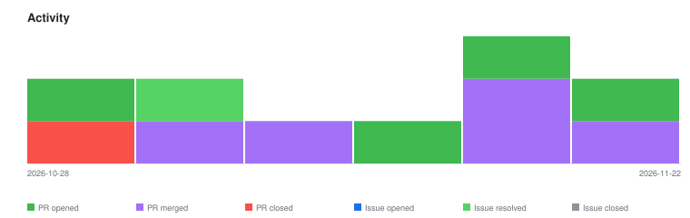

# qte77/gha-ai-changelog — Timeline

<!-- activity-svg-embed -->

<!-- open-section-start -->
## Open

- [ISSUE #42] chore(ci): adopt qte77/.github reusable release workflows (2026-06-28) [open]
- [ISSUE #39] docs: adopt README doc-structure canon (2026-06-21) [open]
<!-- open-section-end -->

## History

2026-11-23

- [PR #53] chore(claude): set Claude Code output and autocompact env (2026-11-22) [closed]

2026-11-16

- [PR #52] ci: pin workflow actions to full commit SHAs (2026-11-12) [closed]
- [PR #51] chore(deps): bump callowayproject/bump-my-version from 1.6.3 to 1.8.1 (2026-11-08) [closed]

2026-11-10

- [PR #49] chore(deps): bump callowayproject/bump-my-version from 1.4.1 to 1.6.3 (2026-10-25) [closed]
- [ISSUE #45] GitHub Models retired 2026-07-30 - action is non-functional, no fallback exists (2026-08-11) [closed]
- [PR #50] fix(action)!: replace retired GitHub Models with configurable LLM provider (2026-10-28) [closed]
- [PR #48] fix(action)!: replace retired GitHub Models with configurable LLM provider (2026-10-24) [closed]

