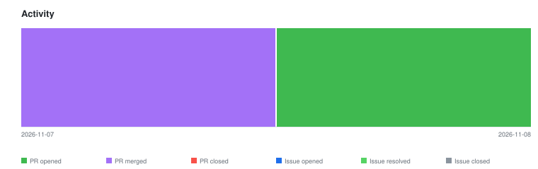

# qte77/gha-ai-changelog — Timeline

<!-- activity-svg-embed -->

<!-- open-section-start -->
## Open

- [ISSUE #42] chore(ci): adopt qte77/.github reusable release workflows (2026-06-28) [open]
- [ISSUE #39] docs: adopt README doc-structure canon (2026-06-21) [open]
- [PR #51] chore(deps): bump callowayproject/bump-my-version from 1.6.3 to 1.8.1 (2026-11-08) [open]
<!-- open-section-end -->

## History

2026-11-10

- [PR #49] chore(deps): bump callowayproject/bump-my-version from 1.4.1 to 1.6.3 (2026-10-25) [closed]

