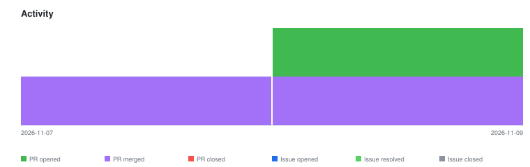

# qte77/gha-contribution-ascii — Timeline

<!-- activity-svg-embed -->

<!-- open-section-start -->
## Open

- [ISSUE #98] chore(ci): adopt qte77/.github reusable release workflows (2026-06-28) [open]
<!-- open-section-end -->

## History

2026-11-10

- [PR #105] PR bump-14-main [skip ci bump] (2026-11-09) [closed]
- [PR #103] chore(deps): bump callowayproject/bump-my-version from 1.4.1 to 1.6.3 (2026-10-21) [closed]

