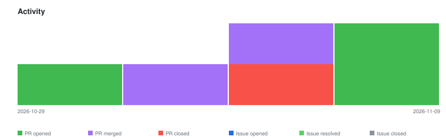

# qte77/gha-cross-repo-issue-sync — Timeline

<!-- activity-svg-embed -->

<!-- open-section-start -->
## Open

- [ISSUE #79] chore(ci): adopt qte77/.github reusable release workflows (2026-06-28) [open]
- [ISSUE #57] chore: publish to GitHub Marketplace (2026-04-05) [open]
- [PR #90] PR bump-11-main [skip ci bump] (2026-11-09) [open]
- [PR #89] chore(deps): bump callowayproject/bump-my-version from 1.6.3 to 1.8.1 (2026-11-09) [open]
<!-- open-section-end -->

## History

2026-11-10

- [PR #87] chore(deps): bump callowayproject/bump-my-version from 1.4.1 to 1.6.3 (2026-10-26) [closed]
- [PR #81] chore(deps): bump github/codeql-action from 4 to 4.37.4 (2026-08-03) [closed]

