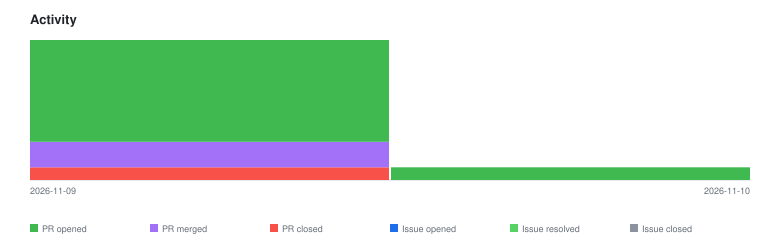

# qte77/gha-dirtree-to-readme — Timeline

<!-- activity-svg-embed -->

<!-- open-section-start -->
## Open

- [ISSUE #95] chore(ci): adopt qte77/.github reusable release workflows (2026-06-28) [open]
- [PR #109] chore(deps-dev): bump mkdocs-section-index from 0.3.9 to 0.3.12 (2026-11-09) [open]
- [PR #108] chore(deps-dev): bump griffe from 1.5.4 to 2.4.1 (2026-11-09) [open]
- [PR #107] chore(deps-dev): bump mkdocs-literate-nav from 0.6.1 to 0.6.3 (2026-11-09) [open]
- [PR #106] chore(deps-dev): bump mkdocs-gen-files from 0.5.0 to 0.6.1 (2026-11-09) [open]
- [PR #105] chore(deps-dev): bump pytest from 9.0.3 to 9.2.0 (2026-11-09) [open]
- [PR #104] chore(deps): bump callowayproject/bump-my-version from 1.4.1 to 1.8.1 (2026-11-09) [open]
- [PR #96] chore(deps): bump actions/setup-python from 6 to 7 (2026-07-26) [open]
<!-- open-section-end -->

## History

2026-11-10

- [PR #110] PR bump-8-main [skip ci bump] (2026-11-09) [closed]
- [PR #103] fix(deps): clear uv.lock security alerts; Dependabot uv ecosystem (2026-11-09) [closed]
- [PR #100] chore(deps): bump callowayproject/bump-my-version from 1.4.1 to 1.6.0 (2026-10-11) [closed]
- [PR #111] fix(ci): deploy docs on push to main, not on closed PRs (2026-11-10) [closed]

