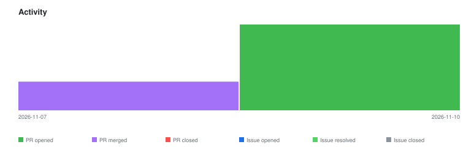

# qte77/gha-github-mirror-action — Timeline

<!-- activity-svg-embed -->

<!-- open-section-start -->
## Open

- [ISSUE #41] feat: mirror modes — authenticated source, GitHub target, router (2026-09-09) [open]
- [ISSUE #11] Full rollout: populate config/repos.yaml with all qte77 repos (2026-03-24) [open]
- [ISSUE #10] Test mirror-all with real accounts (single repo) (2026-03-24) [open]
- [ISSUE #9] Add GITLAB_PAT + CODEBERG_PAT as repo secrets (2026-03-24) [open]
- [ISSUE #8] Create Codeberg account + setup (2026-03-24) [open]
- [ISSUE #7] Create GitLab account + setup (2026-03-24) [open]
- [PR #53] chore(deps): bump actions/checkout from 6.0.2 to 7.0.1 (2026-11-10) [open]
- [PR #52] chore(deps): bump DavidAnson/markdownlint-cli2-action from 23.0.0 to 25.0.0 (2026-11-10) [open]
- [PR #51] chore(deps): bump github/codeql-action from 4.39.1 to 4.39.3 in the github-actions-minor-patch group (2026-11-10) [open]
<!-- open-section-end -->

## History

2026-11-10

- [PR #45] chore(deps): bump github/codeql-action from 4.37.4 to 4.39.1 in the github-actions-minor-patch group across 1 directory (2026-09-09) [closed]
- [ISSUE #33] docs: adopt README doc-structure canon (2026-06-21) [closed]
- [PR #49] docs: restructure README to qte77 canon, add CONTRIBUTING.md (2026-09-09) [closed]

