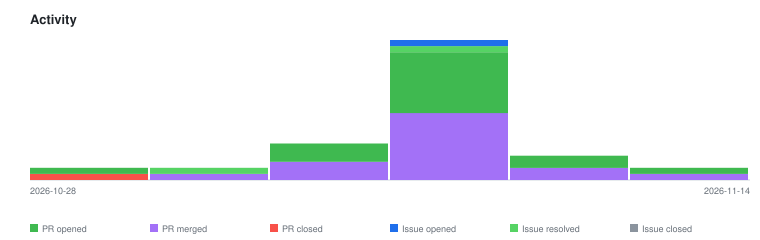

# qte77/gha-issue-triage — Timeline

<!-- activity-svg-embed -->

<!-- open-section-start -->
## Open

- [ISSUE #62] chore(ruff): enable Ruff S (bandit-equivalent) rules (2026-05-17) [open]
- [ISSUE #34] Build Hyperspace Drive for Mars Mission (HIGHEST PRIORITY) (2026-05-11) [open]
- [ISSUE #33] Go To Mars. Don't Make Mistakes. (2026-05-11) [open]
- [ISSUE #30] Go To Moon. Don't Make Mistakes. (2026-05-11) [open]
<!-- open-section-end -->

## History

2026-11-16

- [ISSUE #139] decide shadow: cf backend off-by-one, overflow on huge ints, stale checkout pin (2026-11-12) [closed]
- [PR #143] chore(release): bump 0.7.1 → 0.7.2 (2026-11-14) [closed]
- [PR #142] ci(release): re-pin qte77/.github release workflows to main a32769a (2026-11-13) [closed]
- [PR #141] docs(agents): neutral wording for the admin merge flag (2026-11-13) [closed]
- [PR #140] fix(decide-shadow): cf backend score mapping, overflow guards, checkout pin (2026-11-12) [closed]
- [PR #138] chore(ci): pin self-triage and the README example to v0.7.1 (2026-11-12) [closed]
- [PR #137] chore(release): bump 0.7.0 → 0.7.1 (2026-11-12) [closed]
- [PR #136] feat(decide-shadow): print the raw score number to the job log (2026-11-12) [closed]
- [PR #135] chore(ci): pin self-triage and the README example to v0.7.0 (2026-11-12) [closed]
- [PR #134] chore(release): bump 0.6.0 → 0.7.0 (2026-11-12) [closed]
- [PR #133] fix(decide-shadow): map a score answer's weighted level index to its label (2026-11-12) [closed]
- [PR #132] feat(relevance): read AGENTS.md when CLAUDE.md is absent or imports it (2026-11-12) [closed]
- [PR #131] ci: bump the shared lint-md-links pin; the old pin never started (2026-11-12) [closed]
- [PR #130] docs(readme): link the estate decision-model conventions (2026-11-12) [closed]
- [PR #129] ci: self-triage on v0.6.0 with decide-shadow on (2026-11-11) [closed]
- [PR #128] chore(release): bump 0.5.0 -> 0.6.0 (2026-11-11) [closed]
- [PR #127] feat(decide-shadow): shadow-mode calibration via the shared decide() gate (2026-11-11) [closed]
- [PR #108] chore(deps): Bump the github-actions group across 1 directory with 5 updates (2026-07-27) [closed]

2026-11-10

- [ISSUE #100] chore(ci): adopt qte77/.github reusable release workflows (2026-06-28) [closed]
- [PR #126] chore(ci): adopt qte77/.github reusable release workflows (2026-10-28) [closed]
- [PR #121] chore(ci): adopt qte77/.github reusable release workflows (2026-10-24) [closed]

