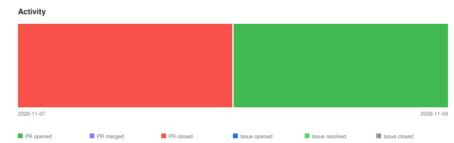

# qte77/gha-llms-txt-action — Timeline

<!-- activity-svg-embed -->

<!-- open-section-start -->
## Open

- [ISSUE #17] ci: adopt actionlint + zizmor for GitHub Actions hygiene (2026-06-29) [open]
- [ISSUE #16] chore(ci): adopt qte77/.github reusable release workflows (2026-06-28) [open]
- [ISSUE #15] docs: adopt README doc-structure canon (2026-06-21) [open]
- [ISSUE #6] FR: derive entry title/description from each doc's YAML frontmatter (2026-04-26) [open]
- [PR #19] ci: add release workflows (thin callers of qte77/.github reusables) (2026-11-09) [open]
<!-- open-section-end -->

## History

2026-11-10

- [PR #18] chore(deps): bump github/codeql-action from 4 to 4.37.3 (2026-08-01) [closed]

