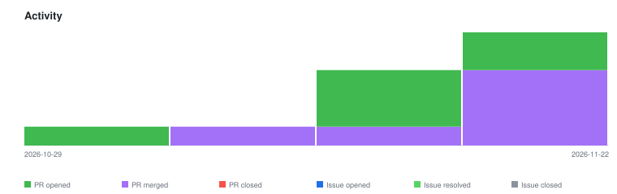

# qte77/gha-runner-gui-kit — Timeline

<!-- activity-svg-embed -->

<!-- open-section-start -->
## Open

- [PR #11] chore(deps): bump actions/upload-artifact from 4.6.2 to 7.0.2 (2026-11-12) [open]
- [PR #10] chore(deps): bump actions/checkout from 5.1.0 to 7.0.1 (2026-11-12) [open]
<!-- open-section-end -->

## History

2026-11-16

- [PR #9] ci(security): pin actions to commit SHAs, add grouped Dependabot (2026-11-12) [closed]

2026-11-10

- [PR #8] docs: describe private projects by role, not name (2026-10-29) [closed]

