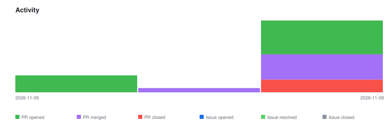

# qte77/gha-rxiv-feed-action — Timeline

<!-- activity-svg-embed -->

<!-- open-section-start -->
## Open

- [ISSUE #171] chore(ci): adopt qte77/.github reusable release workflows (2026-06-28) [open]
- [ISSUE #107] feat(arxiv): align output CSV schema with downstream eval action (2026-05-20) [open]
- [ISSUE #99] Add SocArxiv (OSF-backed) fetcher behind SERVER dispatch (2026-05-20) [open]
- [ISSUE #98] Add weekly SVG visualization (bash+awk, GH light/dark) (2026-05-20) [open]
- [ISSUE #69] Add chemRxiv support (separate fetcher behind SERVER dispatch) (2026-05-06) [open]
- [PR #241] chore(release): bump 0.2.4 → 0.3.0 (2026-11-09) [open]
- [PR #240] Chore(deps): bump the codeql-action group with 3 updates (2026-11-09) [open]
<!-- open-section-end -->

## History

2026-11-10

- [PR #239] chore(dependabot): group github/codeql-action sub-actions (2026-11-09) [closed]
- [PR #238] chore: update ./data/biorxiv (2026-11-09) [closed]
- [PR #237] chore: update ./data/arxiv (2026-11-09) [closed]
- [PR #236] chore: update ./data/medrxiv (2026-11-09) [closed]
- [PR #235] chore: update ./data/biorxiv (2026-11-09) [closed]
- [PR #234] chore: update ./data/arxiv (2026-11-09) [closed]
- [PR #233] Chore(deps): bump astral-sh/setup-uv from 9.0.0 to 10.3.3 (2026-11-05) [closed]
- [PR #232] Chore(deps): bump github/codeql-action/analyze from 4.37.3 to 4.39.1 (2026-11-05) [closed]
- [PR #231] Chore(deps): bump github/codeql-action/init from 4.37.3 to 4.39.1 (2026-11-05) [closed]
- [PR #230] Chore(deps): bump github/codeql-action/autobuild from 4.37.3 to 4.39.1 (2026-11-05) [closed]
- [ISSUE #159] docs: adopt README doc-structure canon (2026-06-21) [closed]
- [ISSUE #134] Publish stub/empty CSV at week-start to avoid 404 for in-progress week (2026-05-25) [closed]
- [ISSUE #106] Mirror PR #101 try/except pattern in biorxiv fetch loop (2026-05-20) [closed]
- [ISSUE #105] Extend citation enrichment to biorxiv/medrxiv DOIs (2026-05-20) [closed]
- [ISSUE #70] Add psyArXiv support (OSF-backed fetcher behind SERVER dispatch) (2026-05-06) [closed]
- [PR #229] Chore(deps): bump certifi from 2026.4.22 to 2026.10.18 in the uv group across 1 directory (2026-11-02) [closed]
- [PR #228] chore: update ./data/medrxiv (2026-11-02) [closed]
- [PR #227] chore: update ./data/arxiv (2026-11-02) [closed]
- [PR #226] ci(codeql): pin init, autobuild and analyze to the same v4.37.3 (2026-10-29) [closed]
- [PR #225] docs: adopt README doc-structure canon (2026-10-29) [closed]
- [PR #224] chore(ci): adopt qte77/.github reusable release workflows (2026-10-29) [closed]
- [PR #223] feat: extend citation enrichment to bioRxiv/medRxiv DOIs (2026-10-29) [closed]
- [PR #222] feat: seed header-only CSV at ISO week start (2026-10-29) [closed]
- [PR #221] feat: add psyArXiv fetcher behind SERVER dispatch (2026-10-29) [closed]
- [PR #220] feat: render weekly papers-per-week SVG (bash+awk) (2026-10-29) [closed]
- [PR #219] fix(biorxiv): stop pagination gracefully on API error (2026-10-29) [closed]
- [PR #205] Chore(deps): bump the uv group across 1 directory with 2 updates (2026-10-07) [closed]
- [PR #188] Chore(deps): bump github/codeql-action/analyze from 4.37.0 to 4.37.3 (2026-07-23) [closed]
- [PR #187] Chore(deps): bump astral-sh/setup-uv from 8.2.0 to 9.0.0 (2026-07-23) [closed]
- [PR #186] Chore(deps): bump github/codeql-action/init from 4.37.0 to 4.37.3 (2026-07-23) [closed]
- [PR #185] Chore(deps): bump github/codeql-action/autobuild from 4.37.1 to 4.37.3 (2026-07-23) [closed]
- [PR #184] Chore(deps): bump actions/checkout from 6.0.3 to 7.0.1 (2026-07-23) [closed]

