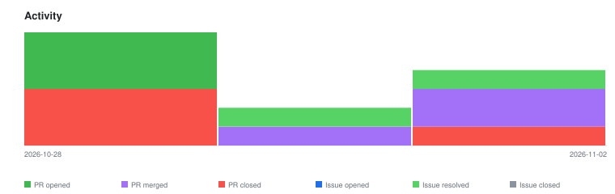

# qte77/gha-rxiv-paper-eval — Timeline

<!-- activity-svg-embed -->

<!-- open-section-start -->
## Open

- [ISSUE #79] chore(ci): adopt qte77/.github reusable release workflows (2026-06-28) [open]
- [ISSUE #76] Sparse biorxiv feed weeks → self-test is low-signal (W24 had 1 row, 0 relevant) (2026-06-27) [open]
- [ISSUE #72] fix(dedup): key dedup on paper IDs / raw feed, not LLM-generated summaries (2026-06-22) [open]
- [ISSUE #71] fix(triage): key triage branch on week/run-id, not date, to avoid same-day collisions (2026-06-22) [open]
- [ISSUE #70] docs: adopt README doc-structure canon (2026-06-21) [open]
- [ISSUE #63] fix(eval): keyword pre-filter drops short acronyms (AMP, LLM, RNA) (2026-05-25) [open]
- [ISSUE #59] feat(workflow): quota-resilience fallback when primary provider hits rate limit (2026-05-25) [open]
- [ISSUE #58] refactor(classifiers): single OpenAIModelSpecClassifier + SDK-backed Anthropic (2026-05-25) [open]
- [ISSUE #55] feat: publish as GitHub Actions Marketplace composite action (2026-05-23) [open]
- [ISSUE #14] Self-test: weekly smoke results (2026-05-11) [open]
<!-- open-section-end -->

## History

2026-11-10

- [ISSUE #80] eval-papers.yaml v0.4.0 passes --max-llm-calls unconditionally — older eval_ref pins exit 2 (workflow/script pin-skew) (2026-07-23) [closed]
- [ISSUE #64] refactor(inputs): rename relevance_prompt → relevance_prompt_template (2026-05-25) [closed]
- [PR #95] ci(release): call qte77/.github reusable tag + publish workflows (2026-10-28) [closed]
- [PR #94] fix(workflow): only pass --max-llm-calls when non-zero (2026-10-28) [closed]
- [PR #93] refactor(inputs): rename relevance_prompt to relevance_prompt_template (2026-10-28) [closed]
- [PR #91] ci(release): call qte77/.github reusable tag + publish workflows (2026-10-24) [closed]
- [PR #90] docs(readme): adopt the README doc-structure canon (2026-10-24) [closed]
- [PR #89] fix(workflow): only pass --max-llm-calls when non-zero (2026-10-24) [closed]
- [PR #88] refactor(inputs): rename relevance_prompt to relevance_prompt_template (2026-10-24) [closed]

