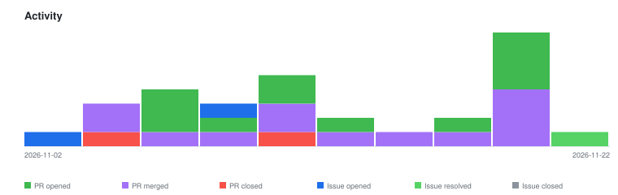

# qte77/gha-sbom-action — Timeline

<!-- activity-svg-embed -->

<!-- open-section-start -->
## Open

- [ISSUE #37] SBOM PRs can't merge under signed-commit and required-CodeQL rules without manual steps (2026-11-02) [open]
<!-- open-section-end -->

## History

2026-11-23

- [ISSUE #42] ci: Lint MD and Links ends in startup_failure since the Actions allow-list change (2026-11-10) [closed]
- [PR #50] chore(deps): Bump qte77/.github/.github/workflows/bump-version.yml from a32769a925e4d056b5d389ad727f7831973f7161 to 4613389d22779a8d8ba623a418f7c94415e49da9 (2026-11-20) [closed]
- [PR #49] chore(deps): Bump qte77/.github/.github/workflows/publish-release.yml from a32769a925e4d056b5d389ad727f7831973f7161 to 4613389d22779a8d8ba623a418f7c94415e49da9 (2026-11-20) [closed]
- [PR #48] chore(deps): Bump qte77/.github/.github/workflows/lint-md-links.yml from 5dfff1f73ac7241ef37b6103e04d2a8373ff68a4 to 4613389d22779a8d8ba623a418f7c94415e49da9 (2026-11-20) [closed]
- [PR #47] chore(deps): Bump qte77/.github/.github/workflows/tag-release.yml from a32769a925e4d056b5d389ad727f7831973f7161 to 4613389d22779a8d8ba623a418f7c94415e49da9 (2026-11-20) [closed]
- [PR #46] fix: keep one SBOM PR per repo and auto-merge it (2026-11-17) [closed]

2026-11-16

- [PR #45] ci(release): re-pin qte77/.github release workflows to main a32769a (2026-11-13) [closed]
- [PR #44] chore(release): bump 0.1.1 → 0.1.2 (2026-11-11) [closed]
- [PR #43] ci(release): re-pin qte77/.github to 43ad121; publish the Release in the tag run (2026-11-11) [closed]
- [PR #41] chore(deps): Bump astral-sh/setup-uv from 10.3.0 to 10.3.3 in the actions-version-updates group across 1 directory (2026-11-10) [closed]
- [PR #39] chore(release): bump 0.1.1 → 0.1.2 (2026-11-09) [closed]

2026-11-10

- [PR #38] fix: commit SBOM updates through the Git Data API so they are signed (2026-11-09) [closed]
- [PR #33] chore(deps): Bump astral-sh/setup-uv from 8.3.2 to 10.3.0 (2026-10-16) [closed]
- [PR #32] chore(deps): Bump anchore/sbom-action/download-syft from 0.24.0 to 0.24.3 (2026-10-09) [closed]
- [PR #27] chore(deps): Bump github/codeql-action from 4 to 4.37.3 (2026-07-31) [closed]
- [PR #40] ci: pin actions to full SHAs; Dependabot uv with groups (2026-11-09) [closed]

