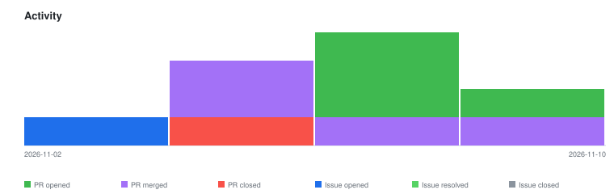

# qte77/gha-sbom-action — Timeline

<!-- activity-svg-embed -->

<!-- open-section-start -->
## Open

- [ISSUE #37] SBOM PRs can't merge under signed-commit and required-CodeQL rules without manual steps (2026-11-02) [open]
- [PR #40] ci: pin actions to full SHAs; Dependabot uv with groups (2026-11-09) [open]
- [PR #39] chore(release): bump 0.1.1 → 0.1.2 (2026-11-09) [open]
<!-- open-section-end -->

## History

2026-11-10

- [PR #38] fix: commit SBOM updates through the Git Data API so they are signed (2026-11-09) [closed]
- [PR #33] chore(deps): Bump astral-sh/setup-uv from 8.3.2 to 10.3.0 (2026-10-16) [closed]
- [PR #32] chore(deps): Bump anchore/sbom-action/download-syft from 0.24.0 to 0.24.3 (2026-10-09) [closed]
- [PR #27] chore(deps): Bump github/codeql-action from 4 to 4.37.3 (2026-07-31) [closed]

