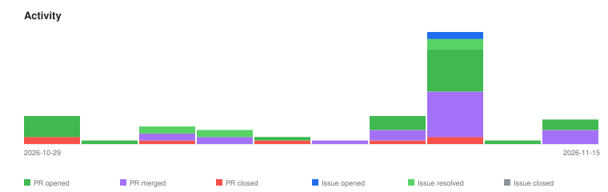

# qte77/polyfetch-scrape — Timeline

<!-- activity-svg-embed -->

<!-- open-section-start -->
## Open

- [ISSUE #292] Persistent browser profile (user_data_dir) for session continuity across runs (2026-11-12) [open]
- [ISSUE #282] Analyse a page's embedded video: find the media URL, download it, extract frames (2026-11-12) [open]
- [ISSUE #261] fetch: streaming to disk — fetch() holds the whole body in memory (2026-10-18) [open]
- [ISSUE #240] security(ssrf): DNS-rebinding TOCTOU, multi-hop redirects, browser subresources (follow-up to #181) (2026-09-30) [open]
- [ISSUE #228] Datacenter-egress bot-challenges survive all three tiers — proxy passthrough proposal (2026-09-25) [open]
- [ISSUE #218] Third-party project mentions need manual redaction (2026-09-21) [open]
- [ISSUE #183] E2E: headless Chromium crashes (SIGSEGV / page-crash) under resource pressure on repeated runs (2026-07-21) [open]
- [ISSUE #179] feat: diagnostic report of browser automation-fingerprint signals (why a target flags the session) (2026-07-19) [open]
- [ISSUE #144] Add a reusable headless ui-check helper (dedupe across consumers) (2026-07-11) [open]
- [ISSUE #59] feat(backend): headed-browser manual-takeover handoff for captcha / hardened blocks (2026-06-22) [open]
<!-- open-section-end -->

## History

2026-11-16

- [ISSUE #200] Enhancement: first-class authenticated sessions in render_session (storage_state + request headers) (2026-08-19) [closed]
- [ISSUE #182] feat(render): opt-in full network-log capture on RenderSession/Response (2026-07-20) [closed]
- [ISSUE #178] feat: resume an authenticated session (storage_state / cookies) on render_session / RenderOptions (2026-07-19) [closed]
- [PR #298] docs(patchright): scope of the #183 crash retry; pin context.close() on a dead browser (2026-11-15) [closed]
- [PR #297] fix(patchright): retry a crashed render target; raise BrowserCrashed instead of a raw error (2026-11-15) [closed]
- [PR #296] docs(ssrf): record the #240 easter_hunt decision; correct the trust_env note (2026-11-15) [closed]
- [PR #295] fix(ssrf): pin the connect address and check every redirect hop (httpx, curl_cffi) (2026-11-14) [closed]
- [PR #294] chore(release): bump 0.10.0 -> 0.11.0 (2026-11-12) [closed]
- [PR #293] feat(render): opt-in full network log with SSE via a separate CDP session (#182) (2026-11-12) [closed]
- [PR #291] feat(render): authenticated sessions via storage_state, cookies, and extra_http_headers (#200) (2026-11-12) [closed]
- [PR #290] docs(changelog): fragment for the patchright 1.64.4 bump (2026-11-12) [closed]
- [PR #289] docs: one project description across GitHub, README and pyproject (2026-11-12) [closed]
- [PR #288] chore(deps): bump anyio to 4.16.0 (unblocks #280) (2026-11-12) [closed]
- [PR #287] docs(readme): consolidate README, fix falsified claims in README and docs (2026-11-12) [closed]
- [PR #286] docs: sync roadmap and user stories with recent features (2026-11-12) [closed]
- [PR #285] chore(claude): allowlist read-only commands seen in recent sessions (2026-11-12) [closed]
- [PR #284] docs(scripting): embedded-video find/download/inspect recipe (#282) (2026-11-12) [closed]
- [PR #283] docs(plans): record the plan 010 pause; drop operator commands (2026-11-12) [closed]
- [PR #281] chore(ci): bump the github-actions group with 2 updates (2026-11-12) [closed]
- [PR #280] chore(deps): bump the python-deps group across 1 directory with 6 updates (2026-11-09) [closed]
- [PR #204] feat(render): opt-in full network-log capture (#182) (2026-08-23) [closed]
- [PR #203] feat(render): authenticated sessions via storage_state + extra_http_headers (#200) (2026-08-23) [closed]

2026-11-10

- [PR #279] chore(release): bump 0.9.0 -> 0.10.0 (2026-11-09) [closed]
- [PR #278] refactor(easter-hunt): extract seed-file reading from _resolve_seeds (2026-11-09) [closed]
- [PR #277] fix(claude): rewrite dead multi-colon permission rules in space form (2026-11-09) [closed]
- [PR #276] chore(deps): bump the python-deps group across 1 directory with 5 updates (2026-11-05) [closed]
- [PR #270] chore(ci): bump the github-actions group across 1 directory with 3 updates (2026-10-29) [closed]
- [PR #269] chore(deps): bump the python-deps group across 1 directory with 4 updates (2026-10-29) [closed]
- [ISSUE #260] fetch: an unfollowed 302 on the httpx tier is returned as success (exit 0, 0 bytes) while curl_cffi follows it (2026-10-16) [closed]
- [ISSUE #256] patchright tier: reading content during a client-side redirect raises Patchright's raw 'page is navigating' error (2026-10-11) [closed]
- [ISSUE #255] cli: --screenshot-out crashes with a raw FileNotFoundError when its parent directory does not exist (2026-10-11) [closed]
- [ISSUE #254] fetch: a login wall (LinkedIn status 999 → /authwall) is returned as a normal response, not an error (2026-10-11) [closed]
- [PR #275] chore(deps): bump filelock from 3.32.2 to 4.2.1 (2026-10-30) [closed]
- [PR #274] fix(fetch): surface redirect_to for any 3xx; --show-body fails on an unfollowed redirect (2026-10-29) [closed]
- [PR #273] fix(patchright): handle reading content during a client-side redirect (2026-10-29) [closed]
- [PR #272] fix(fetch): treat a final status outside 2xx/3xx (e.g. 999 login wall) as an error (2026-10-29) [closed]
- [PR #271] fix(cli): create missing output dirs instead of crashing on --screenshot-out (2026-10-29) [closed]
- [PR #268] chore(ci): bump the github-actions group with 2 updates (2026-10-22) [closed]
- [PR #267] chore(deps): bump the python-deps group with 3 updates (2026-10-22) [closed]

