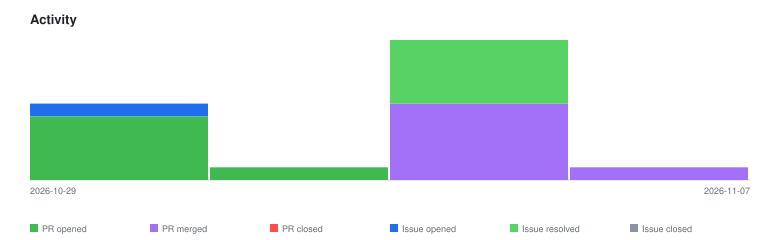

# qte77/polyforge-orchestrator — Timeline

<!-- activity-svg-embed -->

<!-- open-section-start -->
## Open

- [ISSUE #94] Port the cloud-session lane scripts (wave, goal, salvage, salvage-pr) into scripts/ (2026-10-29) [open]
- [ISSUE #92] cc-parallel.sh follow-ups after #91: cost field, budget cap, concurrency, ad-hoc permission mode, resume (2026-10-24) [open]
- [ISSUE #88] config: repos.conf and contributions.json disagree; pending tasks lack issue anchors (2026-10-03) [open]
- [ISSUE #71] research: extend WakaTime capture beyond VSCode (shell hooks for agent activity) (2026-05-26) [open]
- [ISSUE #69] orcahand-warmup: contribution sprint (deferred) (2026-05-22) [open]
- [ISSUE #65] design: clarify MEMORY.md role vs AGENT_LEARNINGS.md in compound learning infra (2026-05-02) [open]
- [ISSUE #61] fix(contrib): actionable error when fork PAT scope insufficient (2026-04-27) [open]
- [ISSUE #39] chore: migrate license to Apache-2.0 — HybridRAG-eval (2026-04-13) [open]
- [ISSUE #36] docs: document PAT scope requirements for contrib_setup (2026-04-05) [open]
<!-- open-section-end -->

## History

2026-11-10

- [PR #90] chore(deps-dev): bump markdown-it from 14.3.0 to 14.3.3 in the npm_and_yarn group across 1 directory (2026-10-23) [closed]

