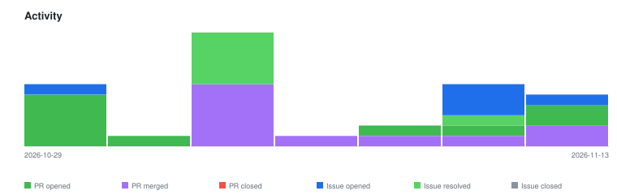

# qte77/polyforge-orchestrator — Timeline

<!-- activity-svg-embed -->

<!-- open-section-start -->
## Open

- [ISSUE #106] Multi-session steering: closed session hierarchy, inbound settings per role, merge-gate script (2026-11-13) [open]
- [ISSUE #104] Actions-policy script: report tag-pinned uses: refs and settings drift, apply on request (2026-11-12) [open]
- [ISSUE #103] Estate sweep: mark Dependabot alerts already fixed on the default branch (2026-11-12) [open]
- [ISSUE #94] Port the cloud-session lane scripts (wave, goal, salvage, salvage-pr) into scripts/ (2026-10-29) [open]
- [ISSUE #92] cc-parallel.sh follow-ups after #91: cost field, budget cap, concurrency, ad-hoc permission mode, resume (2026-10-24) [open]
- [ISSUE #88] config: repos.conf and contributions.json disagree; pending tasks lack issue anchors (2026-10-03) [open]
- [ISSUE #71] research: extend WakaTime capture beyond VSCode (shell hooks for agent activity) (2026-05-26) [open]
- [ISSUE #69] orcahand-warmup: contribution sprint (deferred) (2026-05-22) [open]
- [ISSUE #65] design: clarify MEMORY.md role vs AGENT_LEARNINGS.md in compound learning infra (2026-05-02) [open]
- [ISSUE #61] fix(contrib): actionable error when fork PAT scope insufficient (2026-04-27) [open]
- [ISSUE #39] chore: migrate license to Apache-2.0 — HybridRAG-eval (2026-04-13) [open]
- [ISSUE #36] docs: document PAT scope requirements for contrib_setup (2026-04-05) [open]
<!-- open-section-end -->

## History

2026-11-16

- [ISSUE #102] Port the estate status sweep into scripts/ (public by default, --scope switch, fail on empty scan) (2026-11-12) [closed]
- [PR #108] fix(security): override minimatch and katex past upstream's stale ranges (2026-11-13) [closed]
- [PR #107] ci: add a CodeQL workflow (python) (2026-11-13) [closed]
- [PR #105] feat(scripts): port the estate status sweep into scripts/ (public by default, --scope switch) (2026-11-12) [closed]
- [PR #101] fix(security): bump markdownlint-cli to unblock the js-yaml Dependabot update (2026-11-11) [closed]

2026-11-10

- [PR #90] chore(deps-dev): bump markdown-it from 14.3.0 to 14.3.3 in the npm_and_yarn group across 1 directory (2026-10-23) [closed]
- [ISSUE #89] Migrate to AGENTS.md only — remove CLAUDE.md (qte77/qte77#190) (2026-10-03) [closed]
- [ISSUE #79] Add goal_id to contributions.json plan schema (goal-campaign link) (2026-06-29) [closed]
- [ISSUE #77] docs: adopt README doc-structure canon (2026-06-21) [closed]
- [ISSUE #70] fix(setup_lychee): `tar xz -C ... lychee` likely misses binary inside wrapper dir (2026-05-25) [closed]
- [ISSUE #64] Codespaces: gh-gpgsign fails in agent shells ("No secret key") — follow-up to #48 (2026-04-30) [closed]
- [PR #100] docs(codespaces): replace the unverified signing caveat with the confirmed causes (2026-10-30) [closed]
- [PR #99] docs(changelog): add entries for #70, #77, #79, #89 (2026-10-29) [closed]
- [PR #98] docs: move to AGENTS.md only, remove CLAUDE.md (2026-10-29) [closed]
- [PR #97] feat(schema): add optional goal_id to contributions plan def (2026-10-29) [closed]
- [PR #96] docs(readme): adopt README doc-structure canon (2026-10-29) [closed]
- [PR #95] fix(setup_lychee): install binary from release wrapper dir, drop sudo (2026-10-29) [closed]

